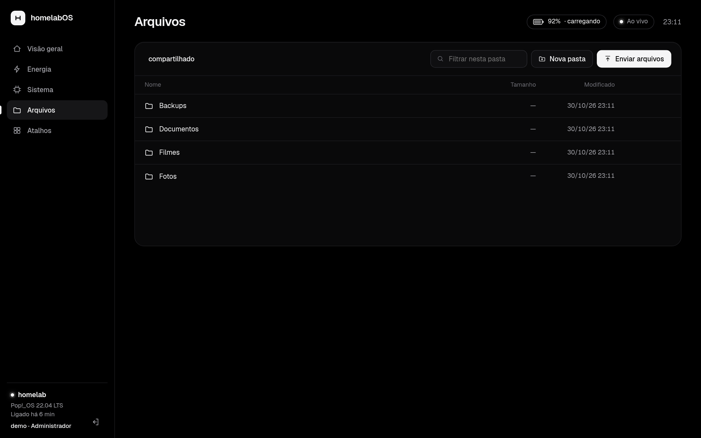
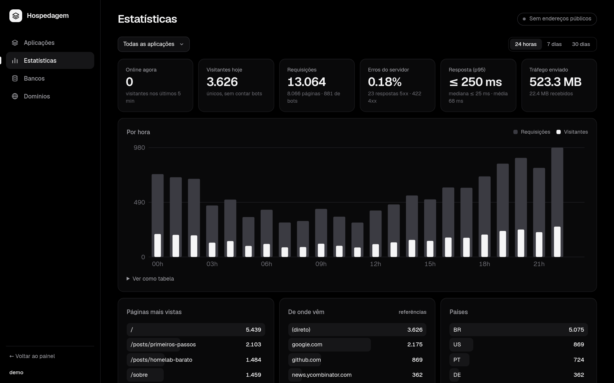

# homelabOS

A tiny, dependency-free control panel for a home server, written in C. Two programs, no frameworks, no database, no JavaScript build step.

- **homelabOS**: live CPU / memory / temperature / network / power metrics (with electricity cost), a file manager for a shared folder, a shortcuts launcher, and a login with an optional second "manager" account.
- **Hosting** (`hosting/`): a self-hosted app platform in the spirit of Dokploy. Deploy from GitHub (webhook or polling) or by uploading a zip/tar.gz, run as a container (Podman, rootless) or a sandboxed process, attach PostgreSQL/MariaDB databases, publish through a Cloudflare Tunnel, and see visitor statistics without storing IPs.

> The UI is in Brazilian Portuguese. The code comments are too. Issues and PRs in English or Portuguese are welcome.

| Overview | Hosting: apps |
|---|---|
|  |  |
|  |  |

More: [login](docs/screens/login.png) · [system](docs/screens/os-sistema.png) · [power](docs/screens/os-energia.png) · [shortcuts](docs/screens/os-atalhos.png) · [mobile](docs/screens/os-mobile.png) · [new app](docs/screens/hosting-nova.png) · [domains](docs/screens/hosting-dominios.png)

## Quick start

Requirements: Linux, `gcc`, `make`. Hosting also uses `git`, `curl`, `python3`, and optionally `podman`, PostgreSQL, MariaDB and `cloudflared`.

```sh
make                 # builds homelabos/homelabos and hosting/hosting
make test            # hermetic test suites (nothing touches your system)

# try it locally, no root needed
cp homelabos/homelab.conf.example homelabos/homelab.conf
./homelabos/homelabos --hash          # type a password, paste the password_hash line into homelab.conf
(cd homelabos && ./homelabos -c homelab.conf)     # http://127.0.0.1:8080
```

Install both as systemd services (code in `/opt`, owned by root; data in `/var/lib/homelabos`, owned by a dedicated user):

```sh
sudo bash deploy/install.sh --hosting
```

By default the panels listen on `127.0.0.1`. To reach them from your LAN, set `bind=<server ip>` in the config. The panel is plain HTTP: put it behind Tailscale/WireGuard or a TLS reverse proxy before exposing it beyond a trusted network.

Hosting authenticates through homelabOS: it asks the homelabOS port who owns the login cookie and with which role. See [`hosting/README.md`](hosting/README.md).

## Security model, in short

Both programs were hardened with the assumption that the source is public and that an attacker can read it. Read [`SECURITY.md`](SECURITY.md) for the threat model, what is protected, what is **not**, and how to report a vulnerability. Highlights:

- Passwords: PBKDF2-HMAC-SHA256 (600k iterations), constant-time checks, per-IP login throttling, 7-day sessions, `HttpOnly; SameSite=Strict` cookies.
- CSRF: every `POST` needs a custom header that cross-origin pages cannot send; hosted apps never receive the panel session cookie.
- Panels refuse to start without a password on a non-loopback address; no "first visitor sets the password" flows.
- Hosting: secrets never in `argv`, sandboxed native apps (Landlock + `no_new_privs`), containers with a PID limit and dropped `NET_RAW`, strict validation of everything that reaches the Cloudflare tunnel config, `curl` config and git commands.
- Only the administrator can run build/start commands directly on the server; other users are limited to containers.

## Repository layout

```
homelabos/   dashboard + file manager (server.c, web/, test.sh)
hosting/     app platform (hosting.c, web/, test.sh)
deploy/      systemd units, installer, database-admin helper
docs/        screenshots
```

## License

MIT. See [`LICENSE`](LICENSE).

## Upgrading an older install

If you already run a previous (pre-hardening) version in `~/homelabOS` and `~/hosting`:
`bash deploy/upgrade-existing.sh [ssh-host] [--manager NAME] [--dry-run]` ships the committed code, builds it on the server, backs everything up, fills in the new config keys, swaps binaries, restarts, checks, and rolls back by itself if a service does not come up.
