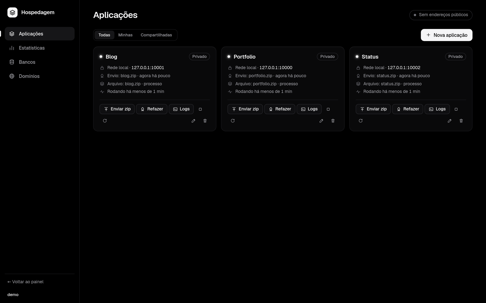

# Hospedagem

Plataforma de aplicações do homelabOS (binário C, porta, serviço e pasta próprios). Um só binário faz tudo: painel web, supervisor de processos, builds, bancos e o túnel do Cloudflare.



## Como funciona
```
GitHub ──push──▶ webhook (ou verificação a cada 2 min) ──▶ git clone/fetch ─┐
zip/tar.gz enviado pelo painel ──▶ extrai e detecta a estrutura ────────────┴▶ build ──▶ troca a versão
                                                                              │
                                  Dockerfile?  sim ▶ podman build + run (rootless, --memory, volume nomeado)
                                               não ▶ comando de build + processo supervisionado (PORT), em sandbox
visitante ──▶ cloudflared (túnel "hosting") ──▶ proxy contador :<porta 10000-10999> ──▶ app em 127.0.0.1:<porta interna 30000+>
              (ou direto pela LAN/Tailscale, na mesma porta)  └▶ estatísticas (visitantes, páginas, status, latência)
```

## Login, papéis e quem pode rodar comandos
- **Login**: o do homelabOS. A Hospedagem pergunta às portas de `dash_ports` quem é o dono do cookie `hl` e qual o papel (`admin` ou `gestor`). Não há contas próprias.
- **Token de API** (`data/api_token`, 0600): `Authorization: Bearer <token>` age como o administrador (`admin=` do `hosting.conf`, igual ao `admin=` do `homelab.conf`). Só vale na porta do painel; pelo túnel público só entra `/hook/`.
- **Privado x compartilhado**: cada app, banco e domínio é "só meu" ou "de todos". Um app compartilhado só liga banco e domínio compartilhados.
- **Comandos no servidor**: build e início "direto no servidor" só para o administrador e para quem estiver em `native_users=`. Os demais ficam só com container (Dockerfile); o painel e o servidor impõem isso.
- **Sandbox** (`sandbox=1`, padrão): apps nativos e seus builds rodam com Landlock: sistema só leitura, `HOME` próprio, escrita só na pasta do app e em `/tmp`, `no_new_privs`. `data/`, `~/.cloudflared`, `~/.ssh` e `sudo` ficam inacessíveis. Veja os limites em [`../SECURITY.md`](../SECURITY.md).
- **Reinício automático**: app que cai volta com espera crescente (2, 4, 8… até 30 s). Um build por vez. Deploy novo reinicia o app (sem zero-downtime).

## Projetos por arquivo (zip / tar.gz)
Em "Nova aplicação" escolha **Arquivo (zip)**, selecione o arquivo (até 500 MB) e o servidor extrai, entende a estrutura e sobe.
Para enviar uma nova versão: botão **Enviar zip** no cartão (ou **Refazer** para repetir o último arquivo).
- A extração recusa caminhos absolutos e `..`, preserva o bit de execução e descarta `__MACOSX`. Se o arquivo tem uma única
  pasta por fora (`projeto/...`), o conteúdo dela vira a raiz.
- Estrutura reconhecida, nesta ordem (só quando você não preencheu build/início):

| Encontrou | Build | Início |
|---|---|---|
| `Dockerfile` / `Containerfile` | `podman build` | container |
| `package.json` | `npm ci` (ou `install`) + `npm run build` se existir | `npm start`, ou `server.js` / `index.js` / `app.js` |
| `requirements.txt`, `app.py`, `main.py`, `manage.py` | venv + `pip install -r requirements.txt` | `python app.py` (ou `main.py`/`server.py`), `manage.py runserver` |
| `go.mod` | `go build -o app .` | `./app` |
| `index.html` (raiz, `dist/`, `build/` ou `public/`) | nenhum | servidor estático em `$PORT` |

  O que foi detectado fica salvo (aparece em Execução avançada). Node e Go precisam estar instalados no servidor (ou use
  Dockerfile); sem eles o deploy diz isso em vez de falhar no escuro. Se nada casar, a mensagem pede os comandos.

## Estatísticas e visitantes
O painel tem a seção **Estatísticas** (uma aplicação ou todas, últimas 24 horas, 7 ou 30 dias) e cada cartão mostra "N online agora · M visitantes hoje".
- **Como conta**: cada app tem um proxy na porta pública (a do túnel e da rede), que repassa ao app, que escuta só em `127.0.0.1:<porta interna>`
  (30000+, guardada em `iport` no `app.conf`). Pega tudo: domínio, rede local e Tailscale. O app recebe `HOST=127.0.0.1` e `PORT` = a interna:
  **ele precisa respeitar `HOST`/`PORT`**; um app que escuta em `0.0.0.0` por conta própria ficaria aberto na porta interna, fora da contagem.
- **O que mostra**: online agora (últimos 5 min), visitantes únicos do dia, requisições e páginas por hora (gráfico), bots à parte, páginas mais vistas,
  origem (referer), país (cabeçalho `CF-IPCountry`, só pelo Cloudflare), navegador, dispositivo, respostas 2xx/3xx/4xx/5xx, latência até o primeiro byte
  (mediana e p95, em faixas) e tráfego enviado/recebido.
- **Visitante**: IP vira um hash com sal que muda todo dia (`data/stats.salt`, 0600). **O IP nunca é gravado**, e ninguém é seguido entre dias.
  "Visitantes" de 7/30 dias é a soma dos únicos de cada dia. Bots (User-Agent vazio, `bot`, `curl`, `monitor`…) e respostas de erro não contam como visitante.
  O IP real vem de `CF-Connecting-IP` só quando a conexão é do `cloudflared` (loopback); senão é o endereço de quem conectou.
- **Limites conhecidos**: uma requisição por conexão (o proxy força `Connection: close`; WebSocket/`Upgrade` passa direto como túnel e conta uma vez);
  a latência é até o primeiro byte; até ~16 mil visitantes únicos por app por dia e 80 itens distintos por lista (o resto vira "(outros)"); um reinício
  no meio do dia pode contar de novo quem já tinha visitado antes dele. App parado responde 502 pela porta (antes a conexão era recusada).
- **Onde fica** (em `apps/<id>/`): `stats.tsv` (uma linha por hora), `stats.cur` (hora atual), `top-<dia>.tsv` (listas do dia; guarda 35 dias). Apagar o app apaga tudo.
- API: `GET /api/stats?app=<id|all>&range=24h|7d|30d`.

## Acesso por porta (sem domínio)
Todo app ganha uma porta própria (10000 a 10999, ou a que você escolher em Execução avançada). Com **Acessível pela rede**
marcado, abre em `http://endereço-do-servidor:porta` na LAN ou no Tailscale, sem domínio nenhum. Desmarcado, só o próprio
servidor alcança. Container publica em `0.0.0.0` ou `127.0.0.1` conforme essa opção; apps nativos recebem `HOST` e `PORT`
(o app precisa respeitar `HOST` para escutar só onde você quer; sem isso ele escuta como programou). Mudar a porta ou a
exposição religa o app na hora. Domínio e porta funcionam juntos.

## Domínios e Cloudflare
- `cert_domain=` (opcional) é o domínio do login do `cloudflared` (`~/.cloudflared/cert.pem`), só do administrador.
- Outros domínios: aba Domínios, com um token da API do Cloudflare (modelo "Editar DNS da zona"). Pode ser privado ou compartilhado. O token só aceita letras, números e `_ - . ~ =`.
- Ao digitar o endereço no app, o servidor cria o CNAME para o túnel `hosting` e atualiza o ingress. Um registro que já existe e aponta para outro lugar **não** é sobrescrito.
- O túnel `hosting` é separado de qualquer outro túnel que você tenha. Excluir um app **não** apaga o DNS.

## GitHub
- Repositório: `dono/repo` ou a URL. Privado: cole um token fine-grained (*Contents: read*; para criar o webhook por aqui, também *Webhooks: read and write*). O token vai por cabeçalho, nunca na URL, e fica só em `data/apps/<id>/app.conf` (0600).
- **Webhook instantâneo**: aba Domínios → "Endereço de webhooks". Só `POST /hook/<id>` com assinatura HMAC-SHA256 passa por esse endereço; o resto do painel não fica exposto (qualquer pedido com `Cf-Connecting-Ip`, `X-Forwarded-For` etc. só alcança `/hook/`; se o painel ficar atrás de um proxy seu, use `behind_proxy=1`).
- Sem webhook, o servidor confere `git ls-remote` a cada 2 min.

## Bancos
PostgreSQL e MariaDB locais. Criar um banco gera usuário + senha aleatória (o banco novo é fechado ao `PUBLIC` no PostgreSQL); ligar a um app injeta `DATABASE_URL`, `DB_HOST`, `DB_PORT`, `DB_USER`, `DB_PASSWORD`, `DB_NAME`. Processo nativo usa `127.0.0.1`; container usa `host.containers.internal`.

**Administrador dos bancos**: rode `sudo bash deploy/db-admin.sh <usuário> <pasta data>`. Ele cria `hosting_admin` com senha em `data/pgpass` e `data/mysql.cnf` (0600), e o hosting entra por TCP no loopback. Sem esses arquivos vale o modo antigo (usuário do serviço pelo socket local), que qualquer processo desse usuário também alcança.

## Configuração (`hosting.conf`)
Veja [`hosting.conf.example`](hosting.conf.example): `port`, `bind` (padrão `127.0.0.1`), `web`, `data`, `dash_ports`, `admin`, `native_users`, `cert_domain`, `tunnel`, `sandbox`, `behind_proxy`.

## Pastas (dentro de `data/`, 0700)
```
apps/<id>/app.conf  src/  deploy.log  run.log  history.tsv  data/  home/  stats.tsv  stats.cur  top-<dia>.tsv
stats.salt  api_token  pgpass  mysql.cnf  dbs/<id>.conf  domains.conf  settings.conf  tunnel.id  tunnel.yml  tunnel.log
```

## Instalar e testar
```
make && sudo bash deploy/install.sh --hosting     # na raiz do repositório
make -C .. test                                   # ou ./test.sh aqui: tudo simulado, nada toca em banco, DNS ou túnel de verdade
```
O teste usa painel de login, "GitHub", `psql`/`mariadb`/`podman`/`cloudflared` e a API do Cloudflare falsos. Não cobre o contato com os serviços reais.
